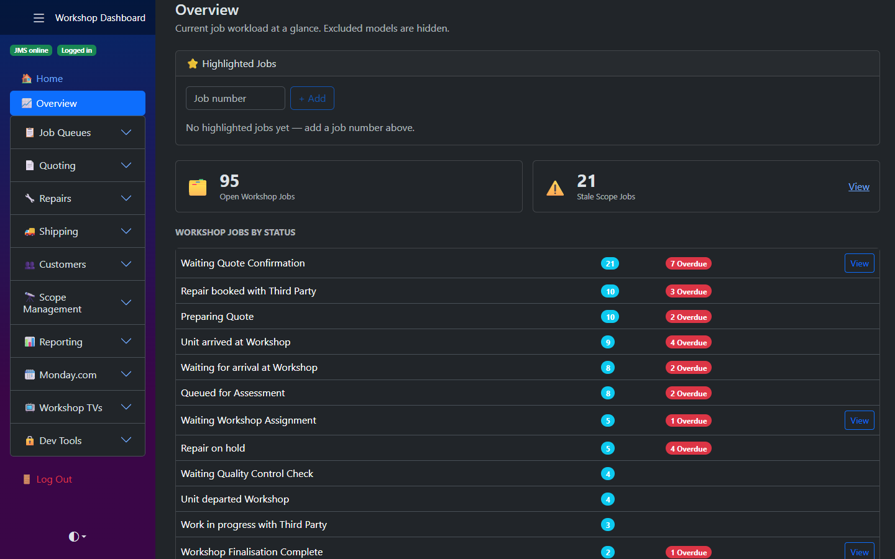

# Workshop Dashboard

[](https://github.com/JacobSchepis/WorkshopDashboard/actions/workflows/ci.yml)

An internal operations app for a medical-equipment repair workshop (flexible and rigid
endoscopes, mostly). It sits on top of the business's existing job management system
("JMS") — which has no API — and turns the daily grind of chasing jobs, pricing repairer
quotes, booking shipments and sending customers updates into a set of focused tools.

It was built by one developer and ran in production for a real workshop, used by the
workshop team from a Raspberry Pi in the office. This repository is a sanitised
copy: company, customer and supplier names are invented, pricing is made up, and it ships
with a **demo mode** that runs the whole thing with no outside services or secrets.



## Try it

**Live demo:** <https://workshop-dashboard-demo-hyeafweeccecfac5.australiaeast-01.azurewebsites.net>
(log in as **demo / demo**). It runs on Azure's free tier, so the first visit after a quiet
spell can take half a minute to wake up, and every visitor shares the same demo data until
the app restarts.

Or run it locally. It needs the [.NET 8 SDK](https://dotnet.microsoft.com/download/dotnet/8.0).

```bash
dotnet run
```

Open <http://localhost:5252> and log in as **demo / demo**.

Demo mode is on by default. It replaces the job management system with an in-process fake
over a seeded database (about 430 jobs across 25 customers, with quotes, shipments, inspections and invoices,
generated with [Bogus](https://github.com/bchavez/Bogus)) and stands in for every other
integration — OpenAI, the courier tracking APIs, Gmail, Google Sheets and monday.com. Every
page, query, pricing rule and write path above those seams is the same code the real
deployment runs. Writes work too: mark a job worked, post a quote, queue a status change,
and the demo data changes.

## What it does

| Area | Highlights |
| --- | --- |
| **Job queues** | One page per workflow stage (waiting assignment, in the workshop, waiting on the customer, finalised, stale) with the actions for that stage inline — mark worked, follow up, change status, track the courier. |
| **Quoting** | Upload a repairer's PDF quote; an LLM extracts the line items into a typed record, deterministic code prices it for the customer's pricing group, and the priced lines post to the job. Six repairer formats, plus in-house quotes where an LLM suggests repair codes from the technician's notes. See [the LLM pipeline](docs/llm-pipeline.md). |
| **Customer updates** | A per-customer "open summary" email — pending quotes, other open jobs, loans, credit — built from live data and sent through Gmail with the quote PDFs attached. |
| **Repairs & loans** | Bulk job creation, document upload, a loan equipment fleet manager with coverage rules, and a service-report builder that merges several JMS reports, calibration certificates and a generated cover and contents into one PDF pack. |
| **Shipping** | Every inbound and outbound consignment in one place, tracked across four carriers (TNT, JMLA, DHL, FedEx) with a shared cache. |
| **Reporting** | Monthly site report packs built by a background worker on the 1st of each month, scope repair reporting, JMS uptime history, and usage analytics with time-saved estimates per action. |
| **Workshop TVs** | Kiosk dashboards for the wall screens: live status counts, rule-based alerts and a team board. Screens pair once with a code instead of logging in. |

## How it's built

- **.NET 8, Blazor Server** (interactive server components) with Blazor.Bootstrap.
- **The job management system is the source of truth.** The app reads it through its own
  SQL export endpoint and writes through the same form posts its pages make — see
  [ADR 0001](docs/adr/0001-integrate-through-the-jms-web-front-end.md).
- **Reads and writes are split.** Reads run as one shared service account behind a
  last-good-result cache, so pages keep working through JMS outages; writes run as the
  logged-in user (so JMS records who did what) and are queued in a database outbox when JMS
  can't take them. See [ADR 0002](docs/adr/0002-shared-read-session-per-user-writes.md) and
  [ADR 0003](docs/adr/0003-queue-writes-in-an-outbox.md).
- **SQLite + EF Core** for the app's own data — settings, overlays on JMS records, the write
  outbox, user accounts, report runs.
- **LLMs propose, code decides.** Extraction is schema-constrained, every code the model
  returns is checked against the real price sheet, and all arithmetic happens in C#. See
  [ADR 0004](docs/adr/0004-llm-proposes-code-decides.md).
- **Demo mode swaps the transport, not the client** — the real JMS client runs against an
  in-process `HttpMessageHandler`, and the real MySQL queries run on SQLite through a small
  translator. See [ADR 0005](docs/adr/0005-demo-mode-at-the-http-transport.md).

More detail, with diagrams, in [docs/architecture.md](docs/architecture.md).

## Project layout

```
Components/           Blazor pages, layouts and shared form components
  Pages/              one folder per area (JobQueues, Quoting, Repairs, Reporting, ...)
  Base/               component base classes: JMS session, kiosk pairing, dev-only
src/
  Services/
    External/Jms/     the JMS client, read/write sessions, cache, outbox, all SQL (JmsQueries)
    External/...      OpenAI, carriers, Gmail, Google Sheets, monday.com
    Quoting/          per-repairer extractors and pricing, the repair suggester
    Jobs/ Workshop/ Reporting/ Shipping/ ...  feature services
    Stores/           the app's own data, one store per concern
  Data/               EF Core context, entities, migrations
  Demo/               demo mode: fake JMS, seed data, MySQL-to-SQLite translation, stand-ins
tests/                xUnit tests
docs/                 architecture, LLM pipeline, ADRs
```

## Tests

```bash
dotnet test
```

About 450 tests: pricing and extraction handling for each repairer, the repair suggester's
validation, the JMS session/cache/outbox behaviour against a fake JMS over real HTTP, and a
test that runs **every** JMS query against the demo database so a query the translator
can't handle fails CI rather than a demo page.

## Running it for real

Set `DemoMode` to `false` and supply the settings listed in
[`Secrets.example/secrets.json`](Secrets.example/secrets.json) — copy it to
`Secrets/secrets.json` (gitignored), or use user secrets or environment variables
(`Jms__BaseUrl`, `OpenAI__ApiKey`, ...). Only the JMS section is required; every other
integration reports itself unconfigured and the rest of the app carries on.

## Docs

- [Architecture](docs/architecture.md) — system context, the JMS integration, data model, demo mode
- [LLM pipeline](docs/llm-pipeline.md) — quote extraction and repair suggestions
- [Architecture decision records](docs/adr/README.md)
- [Timesheet logging](docs/timesheet-logging.md) — how automated work is credited in JMS
