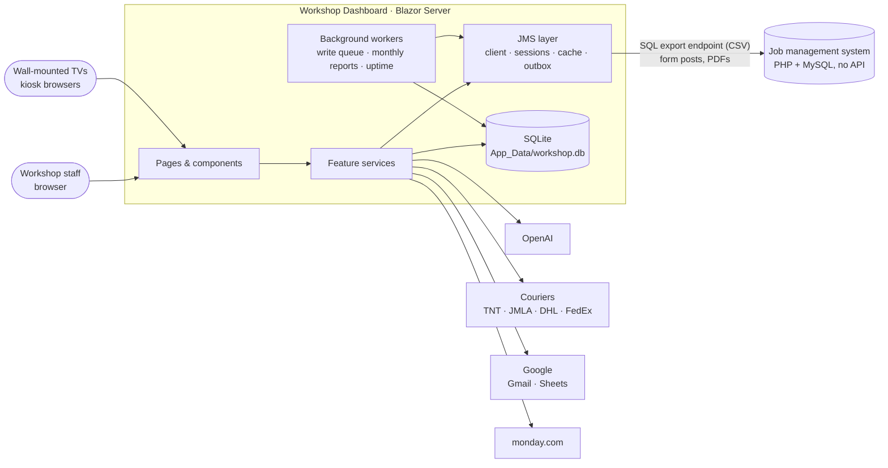
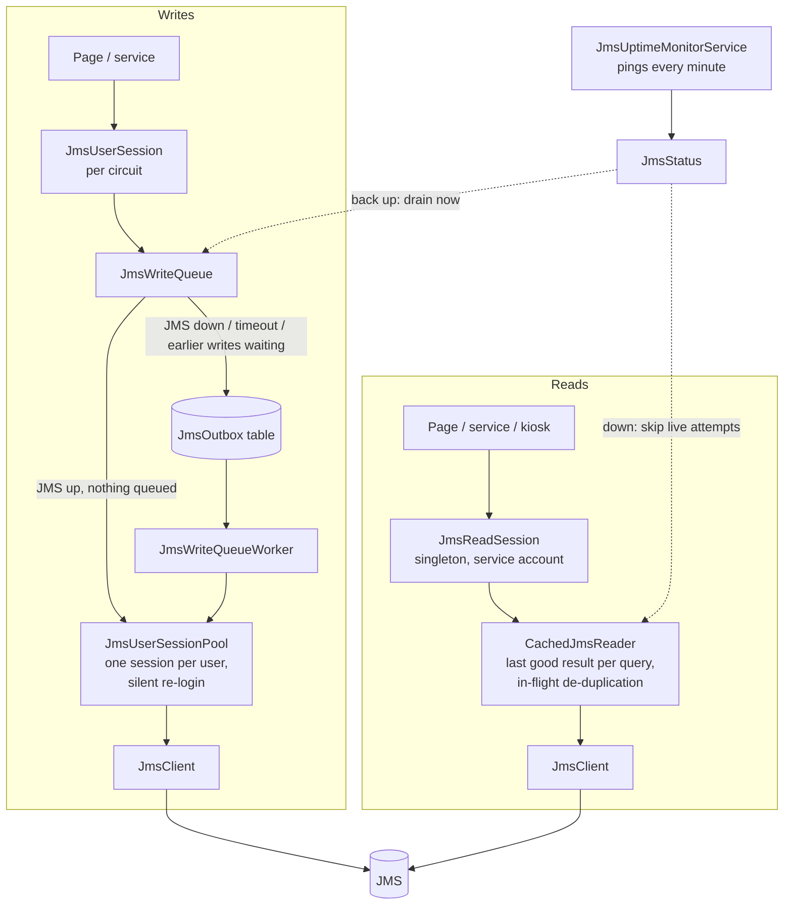
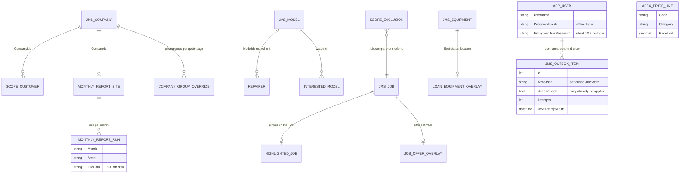
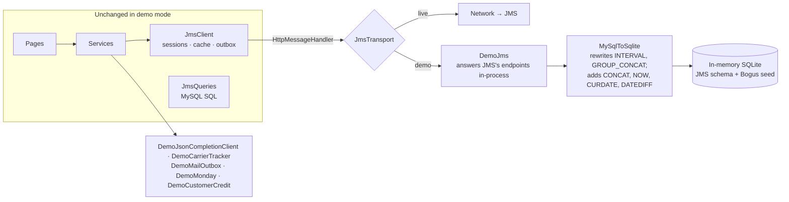

# Architecture

Workshop Dashboard is a single Blazor Server app. It owns very little data of its own: the
business runs on an existing job management system (JMS) — jobs, customers, equipment,
quotes, invoices — and this app is a faster, more opinionated front end over it, plus the
automation that JMS doesn't do.

## System context

Everything outside the app box is optional except JMS. Each other integration reads its own
settings, and if they're missing it reports itself unconfigured and the pages that use it say
so — the rest of the app is unaffected.

## Layers

| Layer | Where | What it knows |
| --- | --- | --- |
| Pages | `Components/Pages` | Layout and UI state. Pages call services; they don't build SQL or talk HTTP. |
| Feature services | `src/Services/{Jobs,Workshop,Quoting,Reporting,Shipping,...}` | Workflow rules: what a "stale job" is, how a quote is priced, what goes in a customer email. |
| Stores | `src/Services/Stores` | The app's own data, one store per concern, each a singleton opening a short-lived `DbContext` per call. |
| JMS layer | `src/Services/External/Jms` | How to talk to JMS. Every SQL statement the app sends lives in `JmsQueries`; every JMS URL comes from `JmsOptions`. |
| Other adapters | `src/Services/External/*` | One class per outside service, behind an interface (`IJsonCompletionClient`, `ICarrierTracker`, `IMailTransport`, ...). |

## The JMS integration

JMS has no API. It has a web front end, and that front end has a page that runs arbitrary
SQL and returns CSV (meant for exporting equipment lists). The app uses exactly what a person
in a browser can: that query page for reads, and the same form posts JMS's own pages make for
writes. [ADR 0001](adr/0001-integrate-through-the-jms-web-front-end.md) covers why, and what
it costs.

Two interfaces split the client by *whose login* a call runs under, not by topic:

- `IJmsReader` — what the shared service account may do: SQL queries, document downloads.
- `IJmsDataClient` — adds everything that must run as the logged-in person: writes, and the
  few reads JMS scopes to the session's own user.

**Reads** always go to JMS live, so someone who has just changed something sees the change.
Each successful result is kept, though, and when JMS is down or a query fails the last good
result is served instead, with a banner saying so. Identical queries already in flight share
one request — the wall TVs and a busy page often ask the same thing at the same moment.

**Writes** run as the logged-in user, so JMS's own audit trail shows who did what. When JMS
can't take a write — it's down, the send timed out, or that user already has writes waiting —
the write is serialised into the `JmsOutbox` table and sent later, in order, as that user. A
send that may have reached JMS unseen (a timeout or 5xx) is marked `NeedsCheck`, and before
it's retried the write is asked whether it is already applied, so nothing lands twice. A
refusal from JMS itself (a 4xx) is reported to the user straight away and not retried. See
[ADR 0003](adr/0003-queue-writes-in-an-outbox.md).

**Logins.** App login is checked against JMS whenever JMS is reachable. On success the
password is stored twice: as a hash, so the person can still log into the app during a JMS
outage, and encrypted with ASP.NET Data Protection, so that when JMS expires their session
mid-day the pool logs them back in silently instead of bouncing them to a login page.

## Kiosks

The workshop TVs can't log in — nobody types a password into a wall-mounted screen. A kiosk
page shows a pairing code; a staff member enters it on `/pair-device`, and the device id
(kept in that browser's local storage) is approved from then on. Kiosks read through the
shared service-account session, so they don't depend on the approver's JMS login.

The notifications screen evaluates a list of rules (`RuleCheckDefinitions`) — "jobs
preparing a quote", "loan units covering a job that's already completed", "loan units overdue
for inspection" — mostly against one shared per-status count query, so the common kind of
rule is a single entry, not a new query.

## Background work

| Worker | Does |
| --- | --- |
| `JmsWriteQueueWorker` | Drains the outbox whenever a write is queued, JMS comes back, or 20 seconds pass. |
| `MonthlyReportWorker` | On the 1st, queues last month's report pack for every enabled site, then builds them one at a time — each is several slow JMS reports merged into one PDF. Outages don't count against a pack's retries. |
| `JmsUptimeMonitorService` | Pings JMS every minute and records only up/down transitions, which the JMS Uptime page turns into daily downtime. |

## The app's own data

JMS stays the source of truth. The app's SQLite database holds what JMS has no place for:
settings, staff-maintained overlays on JMS records, the write outbox, user accounts, report
runs, and a few caches. Almost every table is keyed by a JMS id rather than having foreign
keys of its own.

The `JMS_*` entities live in JMS, not here. Other tables, not shown, hold quote notices,
manufacturer abbreviations, customs data, loan statuses, team notices and tasks, carrier
tracking cache, JMS outage periods and per-action time-saved estimates. Usage analytics is
append-only NDJSON under `App_Data/analytics`, one file per month, rather than a table —
page-view volume made read-modify-write too slow.

## Demo mode

`DemoMode=true` (the default) changes what's registered in DI and nothing else:

Because the fake sits under the real HTTP client, logins, session cookies, CSV parsing, the
cache and the outbox all run for real. `JmsQueriesRunOnDemoTests` runs every method on
`JmsQueries` through the translator, so a new MySQL-only construct breaks the build instead of
a demo page. See [ADR 0005](adr/0005-demo-mode-at-the-http-transport.md).

## Configuration

Settings are read, each source overriding the last, from `appsettings.json`,
`Secrets/secrets.json` (gitignored; `Secrets.example/secrets.json` lists every key), user
secrets in Development, and environment variables (`Jms__BaseUrl`, `OpenAI__ApiKey`). The JMS
section is validated at startup, so a missing value stops the app with a readable list
instead of failing halfway through a form; everything else is optional.
