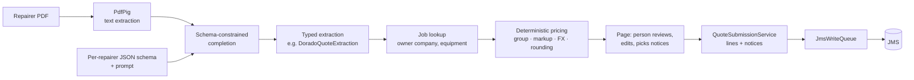
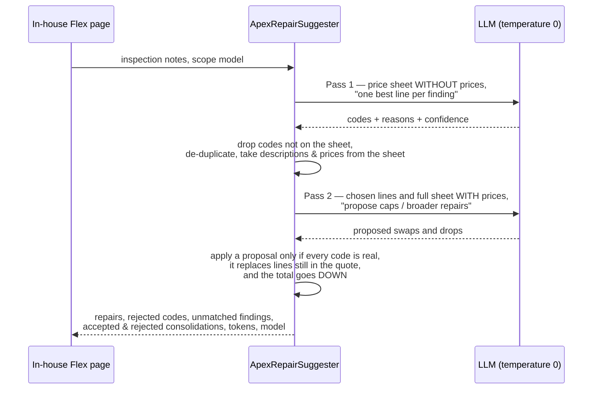

# The LLM pipeline

Two jobs in the workshop involve reading unstructured text and turning it into priced quote
lines:

1. **Repairer quotes.** Most repairs go out to one of six specialist repairers, each of whom
   sends back a PDF quote in their own layout. Someone used to read each one, work out which
   repair level or line items it described, look up the customer's pricing group, do the
   markup and currency arithmetic in a spreadsheet, and type the result into JMS.
2. **In-house quotes.** For repairs done in-house, a technician writes inspection notes and
   someone matches each finding to a line on the flexible-repair price sheet.

Both now use an LLM for the reading and nothing else. The design rule is the same in both:
**the model proposes, the code decides** ([ADR 0004](adr/0004-llm-proposes-code-decides.md)).

## 1. Repairer quote extraction



**Text first, then the model.** `BaseQuoteExtractor` pulls the words out of the PDF with
PdfPig and sends text, not images. Repairer quotes are generated documents with real text
layers, so this is cheaper, faster and easier to debug than vision input — the text the
model saw can be reproduced exactly.

**Structured output with a strict schema.** Each repairer has an extractor
(`src/Services/Quoting/<Repairer>/<Repairer>QuoteExtractor.cs`) that supplies a system
prompt, a field-by-field user prompt, and a JSON schema. The call uses OpenAI's
`json_schema` response format with `strict: true`, so the reply always parses into the
expected record — required fields present, enums limited to their values,
`additionalProperties: false`. The Dorado extractor, for example, constrains
`works_required` to `"Level 1" | "Level 2" | "Level 3" | "Unrepairable" | ""`.

**Prompts encode what people learned the hard way.** The prompts are specific about the
failure modes seen in real quotes, e.g. for Dorado:

> many semi-rigid and specialty scope quotes have NO level line item at all. If there is no
> level line item, return an empty string. Never guess or infer a level from the description
> or the price.

An empty level is a meaningful answer: it switches the pricing calculator onto a different
path (the quote total is priced as a single line under the Apex formula) rather than
inventing a level.

**Pricing is plain C#.** `DoradoPricingCalculator`, `ApexPricingConfig` and their siblings
take the extracted record and the customer's pricing group and produce the price. That's
where currency conversion (with a configurable AUD/USD rate), markup, volume discount tiers,
specialty surcharges, caps and rounding to the house `$x95` style live — all unit tested, none
of it asked of the model. One guard stops automatic pricing entirely when a quote's numbers
look wrong for the formula and asks a person to check it.

**A person submits.** The page shows the extraction next to the calculated lines, lets the
operator correct the job number or any field, pick the applicable notices (warranty terms,
quote validity and the like — admin-configured, per repairer or global), and then submit. `QuoteSubmissionService` posts the lines through the write queue,
so a JMS outage queues the quote instead of losing it.

## 2. In-house repair suggestions

`ApexRepairSuggester` reads a technician's inspection notes and picks lines from the
flexible-repair price sheet (`ApexPriceSheetStore`) in two passes:



Choices worth calling out:

- **Pass 1 doesn't see prices.** The first question is "what's wrong with this scope?", and
  showing prices invites the model to optimise cost instead of fit.
- **Every code is checked against the sheet.** Codes the model makes up are dropped and listed
  as `RejectedCodes` on the result, so a person can see they happened. Descriptions and
  prices always come from the sheet, never from the model's text.
- **Pass 2 is only allowed to make the quote cheaper.** The model proposes "use cap code X in
  place of A, B and C" or "A already includes B"; the code does the arithmetic and accepts a
  swap only if the new line costs less than what it replaces. Rejected proposals are kept on
  the result with the reason, so the page can show what was considered.
- **Temperature 0 where the model allows it**, so the same notes give the same answer. Some
  reasoning models refuse the setting; `OpenAiQuoteClient` retries without it and the result
  records whether the run was deterministic.
- **Confidence carries through.** A swapped-in line takes the *lowest* confidence of the
  lines it replaced — it's only as sure as its least sure finding.
- **Nothing is posted.** The suggester returns a suggestion; the page shows it with reasons
  and confidence, and a person builds the quote from it.

A Dev Tools page (Repair Suggestion Test) runs the suggester against pasted notes with a
choice of model (the picker lists the rough cost per run) and shows tokens, time taken,
whether the run was repeatable, and both passes' raw JSON — that's
how the model choice and the prompts were tuned.

## The seam

Both pipelines depend on one small interface:

```csharp
public interface IJsonCompletionClient
{
    bool IsConfigured { get; }
    Task<string> CompleteJsonSchemaAsync(string systemPrompt, string pdfText, string userPrompt,
                                         string schemaName, string jsonSchema);
    Task<(string Json, int InputTokens, int OutputTokens, bool TemperatureApplied)>
        CompleteJsonSchemaWithUsageAsync(...);
}
```

`OpenAiQuoteClient` implements it for real. In demo mode, `DemoJsonCompletionClient` builds
an answer from the JSON schema the caller sends — prices for `*_price` fields, repair wording
for observation arrays, the first six-digit number in the text as the job number, codes picked
from the price list in the prompt — so every quote page and the suggester work without a key,
and nothing in the demo needs updating when a schema changes.

## Testing

The model calls themselves aren't unit tested; everything around them is:

- each repairer's pricing rules, including the edge cases the prompts call out
  (`DoradoPricingTests`, `ApexPricingTests`, `RepairerPricingTests`, `InHouseRigidPricingTests`);
- the suggester's interpretation and consolidation rules — invented codes, duplicates,
  swaps that aren't cheaper, drops of lines no longer in the quote
  (`ApexRepairSuggesterTests`);
- the text each quote line is posted with (`QuoteTextTests`, `ApexServiceDescriptionsTests`).

## What I'd do next

- Keep a small set of real (anonymised) quote PDFs with expected extractions and run them as
  an evaluation whenever a prompt or model changes, instead of checking by hand on the test
  page.
- Record each extraction alongside what the operator finally submitted. The difference is
  free labelled data on where the model goes wrong.
- Move the PDF extractors off `gpt-4o` onto the model the suggester settled on, once the
  evaluation set exists to show it's no worse.
